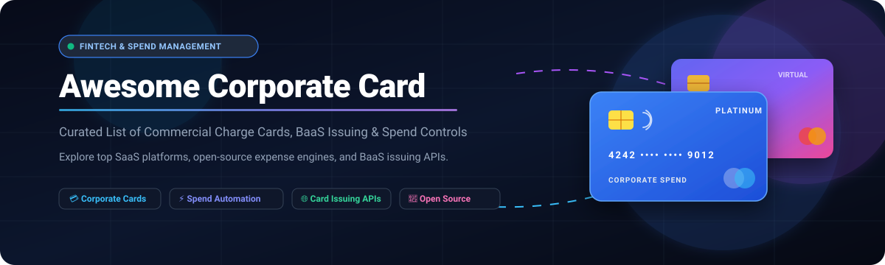

  

# 💳 Awesome Corporate Card

  
  
  

> 🚀 A curated list of leading corporate card platforms, commercial charge cards, spend management software, BaaS card-issuing APIs, and open-source expense tracking infrastructure.

**📅 Last updated: October 2026**

This repository tracks notable **SaaS platforms** and **open-source projects** in the **corporate card** and **spend management** domain. These fintech tools enable modern businesses, startups, and enterprises to issue virtual and physical employee cards, enforce real-time MCC spending limits, automate receipt matching via OCR, and streamline ERP expense reconciliation.

---

## 📑 Table of Contents

- [📊 Sector Overview & Market Dynamics](#-sector-overview--market-dynamics)
- [🏢 SaaS & Hosted Platforms](#-saas--hosted-platforms)
- [💻 Open-Source GitHub Projects](#-open-source-github-projects)
  - [🧾 Enterprise Expense & Spend Management](#-enterprise-expense--spend-management)
  - [⚙️ Card Issuing Infrastructure & BaaS Samples](#-card-issuing-infrastructure--baas-samples)
- [🎯 How to Choose a Corporate Card](#-how-to-choose-a-corporate-card)
- [⭐ Star History](#-star-history)
- [💖 Support](#-support)
- [🤝 How to Contribute](#-how-to-contribute)
- [⚠️ Disclaimer](#-disclaimer)

---

## 📊 Sector Overview & Market Dynamics

The global commercial and corporate card market is estimated at **$44 billion to $47 billion** and is projected to expand toward **$87 billion to $93 billion** at a Compound Annual Growth Rate (CAGR) of **7.0% to 7.7%**, driving trillions in annual B2B transaction volume. 

The sector is **moderately fragmented yet increasingly polarized between legacy enterprise incumbents and winner-take-all software-first fintechs**: established global networks (such as American Express) maintain heavy enterprise T&E dominance, while aggressive hyper-growth platforms (like Ramp and Brex) rapidly capture mid-market and startup FinOps through AI-driven automated reconciliation, zero-fee software tiers, and embedded ERP sync.

---

## 🏢 SaaS & Hosted Platforms

The table below details major commercial corporate cards and spend management SaaS platforms, sorted descending by company scale (valuation or market capitalization):

| Platform | Company Scale (Valuation / Revenue) | Pricing (Starting Tier) | Free Tier Limits / Trial | Key Capabilities & Highlights |
| :--- | :--- | :--- | :--- | :--- |
| **[American Express Business](https://www.americanexpress.com/)** | 🏦 **~$210B Market Cap** ($72.2B annual revenue) | **$0/year** (e.g., Blue Business Plus / Cash); Premium cards up to $895/year (Business Platinum) | **Permanent free tier** ($0 annual fee) with up to 99 employee cards, 2x points or 2% cash back up to $50,000 spend/yr | 🌐 Global acceptance, flexible credit limits (Expanded Buying Power), travel lounges, and direct QuickBooks integration. |
| **[Stripe Corporate Card & Issuing](https://stripe.com/)** | 🦄 **$159B Valuation** (~$6.8B annual revenue) | **$0.10/virtual card**, **$3.00/physical card** + ~$0.20 per transaction volume tiers | **Pay-as-you-go developer model** ($0 monthly platform fee; free testmode sandbox with unlimited virtual card creation) | 🔌 BaaS programmable card issuing, real-time auth webhooks (sub-2s decisions), MCC spend controls, and Treasury balances. |
| **[Shopify Credit](https://www.shopify.com/credit)** | 🛍️ **~$140B Market Cap** (~$3.6B quarterly revenue) | **$0/month** (Requires active Shopify merchant subscription starting at $29/mo) | **Permanent free tier** ($0 card annual fee, no late fees, no foreign transaction fees); underwritten by Shopify store GMV | 💳 Pay-in-full Visa commercial card powered by Stripe/Celtic Bank; up to 3% cash back on top categories; virtual cards instantly. |
| **[Ramp](https://ramp.com/)** | 🚀 **$60B Valuation** (Over $2B annualized revenue) | **$0/user/month** on Free plan; Ramp Plus starts at **$15/user/month** | **Permanent free tier** with unlimited users and cards, basic bill pay (AP), expense management, and QuickBooks/Xero sync | 🤖 AI-driven spend savings, automated receipt matching, ERP integrations, real-time budget vs. actuals, and Ramp Global. |
| **[Mercury Card (IO)](https://mercury.com/credit)** | 💼 **$5.2B Valuation** (~$1B annualized revenue) | **$0/month** on Standard plan; Mercury Plus starts at **$35/month** ($29.90/mo billed annually) | **Permanent free tier** ($0/mo) with unlimited virtual/physical cards, unlimited users, and free domestic ACH & wires | 💸 1.5% cashback on all card spend, limits scaled to cash balances (no personal guarantee), automated receipt matching. |
| **[Brex](https://www.brex.com/)** | 🌐 **$5.15B Valuation** (Acquired by Capital One; ~$500M ARR) | **$0/user/month** on Essentials plan; Brex Premium starts at **$12/user/month** | **Permanent free tier** for small teams with essential corporate cards, automated receipt capture, and basic spend controls | 📈 Corporate cards with automated ERP vendor creation, VAT reclaim workflows, multi-currency support, and AI expense assistant. |
| **[Divvy (BILL Spend & Expense)](https://www.bill.com/product/corporate-cards)** | 🛡️ **$2.5B Valuation** (Acquired by BILL; ~$100M ARR) | **$0/month** ($0 annual fee, $0 software fee; monetized via card interchange) | **Permanent free tier** with unlimited users, unlimited virtual cards, and enforceable departmental budget limits | 🔒 Charge card with credit lines from $1,000 to $5M, up to 7x rewards on weekly payoffs, and direct sync to NetSuite/QuickBooks. |
| **[Rho Card](https://www.rho.co/)** | 🎯 **~$500M Valuation** (Series B fintech) | **$0/month** on Standard Banking & Card tier; custom pricing for enterprise multi-entity | **Permanent free tier** ($0 monthly platform fee) with unlimited physical/virtual commercial cards and free ACH/wires | 📊 Corporate cards bundled with integrated AP automation, Expenses API for programmatic reporting, and automated receipt sync. |
| **[Capital On Tap](https://www.capitalontap.com/)** | 🇬🇧 **~$100M+ Revenue** (Debt-backed SME credit provider) | **$0/year** (£0/yr) on Classic Card; Pro Card available at **£299/year** | **Permanent free tier** with unlimited employee cards, 1% uncapped cashback, and $0 FX/ATM fees | ✨ Dedicated business credit card with preloading rewards, individual employee card limit controls, and Avios/Virgin Points transfer. |
| **[Torpago](https://torpago.com/)** | 🏛️ **~$55M Valuation** (~$5M+ annual revenue) | Enterprise custom deployment (Starting tiers from **$1,500+/month** implementation/SaaS fee for bank partners) | **14-day institutional sandbox / pilot demo** with provisioned test card bins and simulated webhook authorizations | 🏢 White-label card issuing and spend management infrastructure enabling regional and community banks to launch corporate cards. |

---

## 💻 Open-Source GitHub Projects

Corporate card ecosystems demand banking licenses, Visa/Mastercard network access, and PCI DSS compliance at the plastic issuance layer. Consequently, open-source projects primarily provide **self-hosted expense approval workflows, receipt OCR extraction, subscription audit engines, and BaaS issuing reference implementations**.

Repositories are listed in **descending order by GitHub Stars_Count**:

### 🧾 Enterprise Expense & Spend Management

- **[paperless-ngx/paperless-ngx](https://github.com/paperless-ngx/paperless-ngx)**   
  📑 *Community-driven document and receipt management system with automated OCR.* Indexes scanned receipts, purchase invoices, and card statements with full-text search, machine learning tag matching, and automated email inbox polling for corporate transaction receipts.

- **[actualbudget/actual](https://github.com/actualbudget/actual)**   
  💰 *Privacy-focused, local-first budgeting and multi-account spend tracker.* Supports direct bank and credit card statement syncing (via SimpleFIN and GoCardless), envelope-based corporate budget limits, multi-device sync, and custom transaction categorization.

- **[firefly-iii/firefly-iii](https://github.com/firefly-iii/firefly-iii)**   
  🗄️ *Self-hosted financial and expense manager.* Supports tracking multiple credit card liability accounts, automated rule-based transaction classification, recurring subscription tracking, and CSV/OFX/QIF card statement reconciliation.

- **[invoiceninja/invoiceninja](https://github.com/invoiceninja/invoiceninja)**   
  📦 *Leading open-source billing, invoicing, and expense tracking platform.* Features employee expense approval workflows, vendor payment tracking, multi-currency support, receipt attachments, and seamless conversion of billable corporate card expenses into client invoices.

- **[Expensify/App](https://github.com/Expensify/App)**   
  📱 *The flagship open-source expense management platform (New Expensify).* Features commercial card spend management, real-time SmartScan receipt OCR, multi-level approval hierarchies, global reimbursements across 160+ currencies, and seamless ERP ledger synchronization.

- **[Wondermove-Inc/saaslens](https://github.com/Wondermove-Inc/saaslens)**   
  🔍 *Open-source corporate SaaS and credit card spend reconciler.* Audits recurring card payments against discovered SaaS vendor contracts, identifies unused subscription seats, and highlights anomalous corporate card charges.

- **[Abhinavhaldiya/FinPilot](https://github.com/Abhinavhaldiya/FinPilot)**   
  ⚖️ *Enterprise expense approval and reimbursement platform.* Features role-based access control (Employee, Manager, HR, Finance), multi-level threshold approvals, Tesseract-based receipt OCR, departmental budget limits, and audit trails.

- **[zemio-co/zemio](https://github.com/zemio-co/zemio)**   
  🎓 *Self-hosted expense claim management system.* Offers review lifecycle states (`Draft` → `Pending Approval` → `Accepted`/`Rejected` → `Paid`), multi-tenant workspace separation, encrypted banking details, and PDF audit summaries.

---

### ⚙️ Card Issuing Infrastructure & BaaS Samples

- **[stripe-samples/issuing-treasury](https://github.com/stripe-samples/issuing-treasury)**   
  💳 *Official Stripe reference implementation for building commercial card programs.* Demonstrates virtual card provisioning, real-time authorization webhooks (sub-2s decision responses), MCC authorization restrictions, and spend control architecture.

- **[kater-stripe/platform-issuing](https://github.com/kater-stripe/platform-issuing)**   
  🛠️ *Complete demonstration of Stripe Connect + Issuing.* Features onboarding, virtual card lifecycle controls, MCC category whitelisting/blacklisting, velocity spending limits (£25/day, £500/month), and webhook-based programmatic auth processing.

---

## 🎯 How to Choose a Corporate Card

When evaluating corporate card and spend management providers, benchmark across four foundational criteria:

1. 🔍 **Underwriting Model & Guarantees**: Does the card require a personal guarantee (common with traditional bank credit cards), or is credit underwritten based on cash balances / business revenue (e.g., Ramp, Brex, Mercury)?
2. ⚡ **Software Automation & ERP Integration**: Does the provider offer zero-fee automated receipt OCR, enforceable pre-spend limits, and direct bi-directional synchronization with NetSuite, QuickBooks, or Xero?
3. 🔒 **Card Modalities & Velocity Controls**: Can finance administrators generate single-use virtual cards, set per-merchant spend caps, and restrict specific MCC categories (e.g., blocking gambling or gas stations)?
4. 🌍 **Foreign Exchange & Global Rails**: Does the platform provide native multi-currency balances, zero-fee foreign exchange, and local card issuance for cross-border teams (e.g., USD, EUR, GBP)?

---

## ⭐ Star History

---

## 💖 Support

Thank you for visiting and using this curated directory! If you found this resource helpful, please consider:
- ⭐ **Starring** the repository to show support and boost visibility.
- 🍴 **Forking** the repo and contributing your own insights, tools, or updates.
- 📢 **Sharing** this guide with colleagues, finance teams, and fintech builders.
- ☕ **Buying a coffee / sponsoring** the maintainer to support ongoing open-source curation via the [GitHub Sponsors Dashboard](https://github.com/sponsors/ishandutta2007).

---

## 🤝 How to Contribute

Contributions are welcome! Please follow these guidelines:

1. Fork this repository.
2. Edit or add verified entries in `README.md` following the established table or badge format.
3. Verify that all URLs, pricing tiers, and licensing details are factual and up-to-date.
4. Submit a clear, well-described Pull Request.

---

## ⚠️ Disclaimer

- This repository is a **community-curated index** created for educational and architectural research purposes. It is not affiliated with, sponsored by, or endorsed by any listed company or bank.
- Issuing commercial credit or charge cards requires compliance with **PCI DSS** standards, banking partnerships, and regional AML/KYC regulations.
- Verify pricing plans, terms of service, and reward disclosures directly on official vendor websites before selecting a corporate card solution.
